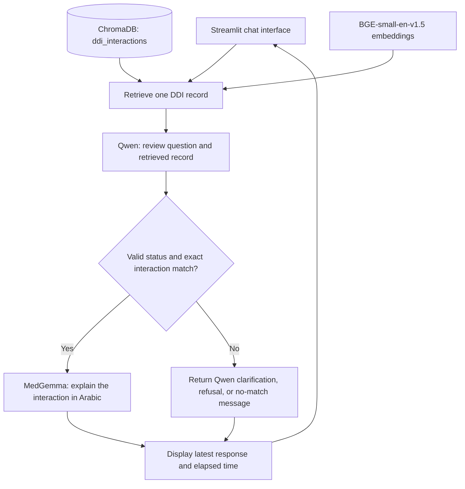

# Know Your Med | اعرف دوائك

A local AI assistant that retrieves drug–drug interaction information, verifies that it matches the user's two medications, and explains the interaction in clear Arabic.

**Team 7 — Generative AI Application Engineering Bootcamp**

**Repository:** [misharix30/Group-7](https://github.com/misharix30/Group-7)

## Project Overview

People taking multiple medications, and family members helping manage them, may find it difficult to understand potential interactions and medical terminology. Know Your Med combines retrieval from an existing interaction dataset with input verification and a patient-friendly explanation.

The implemented approach uses **retrieval-augmented generation (RAG) and prompt engineering**. The initial idea of predicting interactions with a fine-tuned model was replaced by retrieval from existing records. No fine-tuning or alignment training is used in the current application.

### Main Features

- Ask a text question about exactly two medications.
- Retrieve a relevant interaction record using BGE embeddings and ChromaDB.
- Use Qwen to check the question's scope and the retrieved medication pair.
- Generate an Arabic explanation with MedGemma only after an exact interaction-text match.
- View the original interaction, dataset record ID, and response time.
- Display only the latest question and answer; submitting another question replaces the previous turn.

The current scope is drug–drug interactions. A separate medication side-effect lookup and speech input are future features.

## System Architecture



### Request Flow

1. The user submits a question. The interface clears the previous turn and starts timing the request.
2. The retriever embeds the question and searches the saved `ddi_interactions` collection with **`k=1`**.
3. Qwen receives the question and retrieved record. It checks for exactly two medications, verifies the pair in either order, and returns JSON containing `status` and `response`.
4. The application calls MedGemma only when `status` is `valid` and `response` exactly equals the retrieved record's interaction text. Other Qwen messages are displayed directly.
5. MedGemma's current prompt receives **the verified interaction only** and requests a short Arabic explanation in two sentences. The user's question is not included in its formatted prompt. The sentence count is a prompt instruction, not a programmatically enforced limit.
6. The interface displays the answer, elapsed time, and, for matched records, an expandable source section.

Each request is independent. Models and the retriever are cached after the first request, and a shared lock serializes model loading and inference within the application process.

### Models and Technology

| Component | Model or technology | Purpose | License or terms |
| --- | --- | --- | --- |
| Question verification | [Qwen/Qwen3-4B-Instruct-2507](https://huggingface.co/Qwen/Qwen3-4B-Instruct-2507) | Check scope and pair match; extract interaction text | Apache 2.0 |
| Medical explanation | [google/medgemma-1.5-4b-it](https://huggingface.co/google/medgemma-1.5-4b-it) | Explain the verified interaction in Arabic | Health AI Developer Foundations terms |
| Embeddings | [BAAI/bge-small-en-v1.5](https://huggingface.co/BAAI/bge-small-en-v1.5) | Encode questions and interaction records for retrieval | MIT |
| Vector database | ChromaDB | Store embeddings and record metadata | See the dependency's license |
| Interface and orchestration | Streamlit, Python, LangChain | Local chat interface and model pipeline | See individual dependency licenses |

Both language models use **4-bit NF4 quantization**, BF16 computation, and automatic device placement. Exact dependency versions are pinned in [requirements.txt](requirements.txt).

## Data and Preparation

The presentations identify **DrugBank** as the source of the drug–drug interaction data.

| Dataset property | Value |
| --- | --- |
| Original records reported in the idea presentation | 191,808 |
| Records removed for missing values | 267 |
| Cleaned interaction records | 191,541 |
| Unique medications in the cleaned CSV | 1,701 |
| CSV columns | `Drug1_Name`, `Drug2_Name`, `Interaction` |
| Chroma collection | `ddi_interactions` |

Preparation included removing incomplete records, replacing `#Drug1` and `#Drug2` placeholders with actual medication names, trimming whitespace, and checking for duplicates. The technical design reports no duplicates. Interaction direction is preserved. Embeddings and metadata were stored in ChromaDB before application startup.

The application opens the existing index; it does not rebuild embeddings or create a replacement collection automatically.

### Data Sources and Licensing

- **Data provider:** [DrugBank](https://go.drugbank.com/). Usage and redistribution are governed by the applicable [DrugBank terms](https://trust.drugbank.com/drugbank-trust-center/drugbank-terms-of-service) and the license attached to the original dataset download.
- The exact download URL, release identifier, and dataset-specific license document are not recorded in the supplied project materials. The presence of a local CSV or index does not establish redistribution permission; confirm the applicable terms before sharing these data files.
- Model licenses are listed above. Accessing MedGemma requires accepting its model terms on Hugging Face.
- A project-code license has not yet been declared in this repository; third-party models and data retain their own licenses.

## Repository Structure

```text
project/
├── README.md
├── requirements.txt
├── testing_data/                   # Regression tests, reference cases, manual checks
├── notebooks/                      # Data preparation, RAG, and prompt experiments
├── src/                            # Models, prompts, retrieval, pipeline, and UI helpers
├── app.py                          # Streamlit entry point
├── results/                        # Environment reports and saved validation summaries
├── ddi_cleaned.csv                 # Cleaned interaction dataset
├── ddi_chroma_db/
│   └── ddi_chroma_db/               # Complete saved Chroma index
│       ├── chroma.sqlite3
│       └── ...                     # Required index files and segment directories
└── .streamlit/
    └── config.toml                 # Local server and interface settings
```

The `.venv/` environment and downloaded model weights are not part of the source-code distribution. Hugging Face manages downloaded weights in its local cache.

## Installation and Local Setup

### Prerequisites

- Git and [Git LFS](https://git-lfs.com/) installed before cloning; the prepared ChromaDB artifacts are stored with Git LFS.
- Windows with Python **3.11**; the project environment was verified with Python **3.11.9**.
- A compatible NVIDIA GPU and driver. The tested device is an **RTX 5050 Laptop GPU with approximately 8 GB VRAM**, using PyTorch's CUDA 12.8 build.
- At least **6 GiB of free GPU memory** to pass the application's startup check. This check does not guarantee that every generation will fit in memory.
- Internet access for initial package and model downloads, plus a Hugging Face account with access to MedGemma.
- The project's prepared CSV and complete ChromaDB index, obtained under the applicable data license.

The current runtime requires CUDA; a CPU-only execution path is not implemented. Close notebook kernels or other application instances that already hold the models before loading them here.

### 1. Get the Project

```powershell
git lfs install
git clone https://github.com/misharix30/Group-7.git
cd Group-7
git lfs pull
```

Run the remaining commands from the directory containing `app.py` and `requirements.txt`.

### 2. Create the Environment and Install Dependencies

```powershell
py -3.11 -m venv .venv
.\.venv\Scripts\python.exe -m pip install -r requirements.txt
```

The requirements file includes the PyTorch CUDA 12.8 package index. Using the environment's Python executable directly avoids the need to activate the environment.

### 3. Place the Prepared Data

Ensure the following paths exist:

```text
ddi_cleaned.csv
ddi_chroma_db/ddi_chroma_db/chroma.sqlite3
```

Keep **all files and segment directories** from the prepared Chroma index together, not just `chroma.sqlite3`. If the data are absent from the checkout, obtain the prepared artifacts from the team under the applicable license. The CSV alone is insufficient to start this application.

Paths are configured in [src/config.py](src/config.py). Historical notebooks still contain the previous `ddi_chroma_db_backup` directory name; update their database-path cell to the current path before rerunning those experiments. Run notebook kernels from the project root.

### 4. Enable MedGemma Access

Accept the terms on the [MedGemma model page](https://huggingface.co/google/medgemma-1.5-4b-it), then set a Hugging Face read token in the current PowerShell session. This command prompts for the token without displaying it:

```powershell
$env:HF_TOKEN = [System.Net.NetworkCredential]::new('', (Read-Host 'Hugging Face token' -AsSecureString)).Password
```

Keep the token out of source files and Git commits. The first model download requires additional time and disk space. Later launches can reuse the local model cache.

### 5. Start the Application

```powershell
.\.venv\Scripts\python.exe -m streamlit run app.py
```

Open the URL printed in the terminal, normally **http://127.0.0.1:8501**. The server is configured for local access. Models load when the first question is submitted, so its displayed response time includes initialization.

### 6. Try a Question

For example, ask about **Trioxsalen and Verteporfin**. Medication names should match the dataset's naming. The interface accepts text questions; MedGemma explanations are configured to be in Arabic, while Qwen's clarification and rejection messages follow the question's language.

The previous question and answer disappear when a new request is submitted. Restart the Streamlit process after changing model settings or prompts so the cached runtime uses the new configuration.

## Evaluation Results

### Results Reported in the Final Presentation

| Metric | Reported result | Target |
| --- | --- | --- |
| RAG Hit@1, as labeled in the final slides | 91.3% | Above 90% |
| Question classification accuracy | 95% — 19/20 questions | Above 90% |
| Exact interaction-text match | 100% — 20/20 cases | Above 90% |

These are the presentation's historical prototype results, not a new evaluation of the current application or its latest prompts. Classification and extraction were evaluated on small samples; these scores do not measure the medical correctness of MedGemma's explanations.

### Saved Retrieval Notebook Results

[RAG_DDI_Organized.ipynb](notebooks/RAG_DDI_Organized.ipynb) contains a retrieval evaluation using 1,000 sampled records and five question templates per language: **5,000 English and 5,000 Arabic questions**. Correctness is determined by normalized interaction-text matching.

| Language | Hit@1 | Hit@3 | MRR@3 |
| --- | --- | --- | --- |
| English | 91.0% | 91.3% | 0.912 |
| Arabic | 90.6% | 90.9% | 0.907 |

**Metric-label discrepancy:** the final presentation labels 91.3% as Hit@1, whereas the saved notebook reports 91.3% as English Hit@3. Both sources are documented here rather than treating them as the same measurement. The application currently retrieves one record; the notebook evaluates up to three.

### Validation Commands

Check installed dependencies:

```powershell
.\.venv\Scripts\python.exe -m pip check
```

Run the application, parser, pipeline, and saved-database regression checks without loading the language models:

```powershell
.\.venv\Scripts\python.exe -m pytest testing_data/test_app.py testing_data/test_pipeline.py testing_data/test_output_parser.py testing_data/test_database.py -q
```

For a manual real-model smoke test using cached weights, first close other processes holding the models:

```powershell
.\.venv\Scripts\python.exe -m testing_data.live_smoke --offline
```

This smoke test saves case-level metrics and word counts in `results/live_smoke.json`, without saving generated answers. It checks routing and basic responses, not comprehensive medical accuracy. [results/validation.md](results/validation.md) records earlier environment and integration checks; historical reference tests compare prompts against archived notebook versions and may fail after intentional prompt changes.

## Monitoring and Privacy

Response time and processing status are displayed in the interface. Runtime exceptions are logged to the local terminal, and users see an error message when a request fails. Automated alerts and a centralized monitoring dashboard are not implemented.

The application keeps only the latest turn in session memory and does not save chat history to files or a conversation database. Previous questions are not passed to subsequent requests. LangSmith tracing and Chroma telemetry are disabled by the application. Inference runs locally; initial model downloads require network access.

## Limitations and Next Steps

- Missing records or failed retrieval do not establish that a medication combination is safe.
- Exact record matching helps control routing, but model verification and medical explanations can still be incorrect. This is an educational prototype, not a substitute for advice from a qualified healthcare professional.
- Coverage is limited to the supplied dataset, and response speed depends on GPU availability and generation length.
- Next steps from the final presentation include testing alternative models and adding a separate medication side-effect information feature.

## Team and Responsibilities

| Team member | Responsibilities |
| --- | --- |
| Mishari Almutairi | Team lead, project scope, data preparation, ChromaDB and RAG evaluation, Qwen validation, system integration, and presentation coordination |
| Mohammed Alwthinani | Shared data and model experiments, MedGemma Arabic explanation testing, and application integration |
| Both team members | Application development, system testing, documentation, and final presentation |

The README follows the idea, technical-design, and final presentations, with runtime behavior checked against the current source code.
